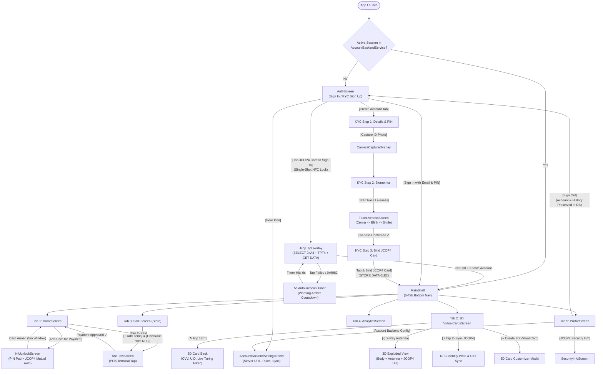

# tap@tan (`Bantay`) — Full-Project Figma Prompt & 3D Interactive Cards Blueprint

> [!TIP]
> **How to Use This Blueprint in Figma**
> - **Section 1 (Master Full-App Prompt):** Paste into **Figma Make / First Draft / AI Prototype** to generate the complete multi-screen mobile design system and prototype flows.
> - **Section 2 (Upgraded 3D Interactive Cards Section Prompt):** Paste specifically when generating or refining the **Cards Tab (`VirtualCardsScreen`)** to create the 3D spatial card deck, 180° flip, gyroscope/pointer tilt, holographic foil shader, and X-Ray JCOP4 chip inspector.
> - **Section 3 & 4 (Flow Architecture & Button Matrix):** Use to wire Smart Animate prototype noodles across all screens, modals, and NFC hardware states.

---

## 1. Master Full-Project Prompt (Copy-Paste into Figma AI)

```text
Design a complete, high-craft dark-mode fintech mobile application and interactive prototype called "tap@tan" (Bantay) — a hardware-backed Java Card NFC (NXP JCOP4 J3R150) tokenized payment and neighborhood Sar-E store ecosystem for Android & iOS.

### VISUAL & DESIGN SYSTEM TOKENS
- Aesthetic: Dark Neo-Brutalist Glassmorphism + Spatial 3D Hardware Telemetry (inspired by Apple Wallet, Revolut Ultra, and Nothing OS).
- Canvas: 393×852 pt (iPhone 16 Pro / modern Android flagship), 20 pt outer padding, 16 pt grid gap.
- Color Palette:
  - Deep Obsidian Canvas: #0A0E17 (Primary BG), #0F172A (Elevated Surface)
  - Frosted Glass Surface: rgba(30, 41, 59, 0.55) with 1px border rgba(255, 255, 255, 0.10) and 20px backdrop blur
  - Primary Cyber Cyan: #0891B2 / #06B6D4 (NFC active, JCOP4 telemetry, primary CTAs)
  - Turing Emerald: #10B981 / #34D399 (Verified TPT4 handshake, armed card state, positive inflow)
  - Royal Indigo: #6366F1 / #8B5CF6 (Virtual card gradients, Sar-E checkout accents)
  - Warning Amber: #F59E0B (5-second auto-rescan countdown, PIN retry warnings, armed expiry timer)
  - Critical Coral: #EF4444 / #F87171 (Unauthorized NFC card 0x6982 alert, PIN blocked, outflow)
- Typography:
  - Headings & Currency Balances: Plus Jakarta Sans / Inter Bold (tracking -0.02em)
  - Hardware UIDs, APDU Status Words (0x9000), & Card Numbers: JetBrains Mono / Space Mono

---

### COMPLETE SCREEN & BUTTON FLOW ARCHITECTURE

#### SCREEN 1: Auth & Hardware NFC Sign-In (`AuthScreen`)
1. Top Brand Header:
   - Glowing cyan shield-nfc emblem, "tap@tan" wordmark, subtitle "JCOP4 Turing-Composed NFC Wallet".
   - Top-right icon button: `[Gear: Account Backend Settings]` -> opens `AccountBackendSettingsSheet` modal.
2. Segmented Mode Switcher:
   - Two pill tabs: `[Sign In]` (active) and `[Create Account / KYC]`.
3. Sign-In Mode Controls:
   - `[Tap JCOP4 Card to Sign In]` (Hero 3D glass CTA card with animated cyan radar rings):
     - Single-action NFC lock: one physical tap executes `SELECT 0xA4` -> verifies `TPT4` handshake -> reads cardholder identity -> routes directly to `MainShell (Home)` if account exists, or pre-fills registration if new.
     - Failed tap state: shows red shake + 5-second circular countdown timer (`Auto-rescanning in 5s...`) before re-arming NFC reader.
   - Saved Accounts Quick-Switch Horizontal Chips: shows persisted local/backend accounts (survives sign-out) with avatar + email; tapping pre-fills email.
   - Input fields: `[Email Address Input]`, `[4–6 Digit PIN Input (obscured toggle)]`.
   - Primary Button: `[Sign In with Email & PIN]` -> validates against `AccountBackendService` -> routes to `MainShell`.
4. Create Account / 3-Step KYC Wizard Mode:
   - Step 1 (Details & PIN): `[Full Name]`, `[Email]`, `[Phone]`, `[Home Address]`, `[Create 4–6 Digit PIN]`, `[Confirm PIN]`, CTA `[Next: Biometric KYC ->]`.
   - Step 2 (Document & Face Liveness):
     - `[Capture Valid ID Photo]` button -> opens `CameraCaptureOverlay` (ID frame guide + shutter button).
     - `[Start Live Face Verification]` button -> opens `FaceLivenessScreen` (3-stage oval progress: Center Face -> Blink Eyes -> Smile 😊 -> "Liveness Confirmed ✓").
   - Step 3 (Bind Physical JCOP4 Card):
     - `[Tap & Bind JCOP4 Smart Card]` button -> opens `JcopTapOverlay` -> writes `CardIdentity` (`STORE DATA 0xE2` Turing frame) and locks hardware UID (`04:7A:93:E2:10:88:01`) to account -> routes to `MainShell`.

#### MODAL 1A: Account Backend Settings Sheet (`AccountBackendSettingsSheet`)
- Toggle: `[Use Remote Node.js Account Backend]` (switches between Offline Local DB and HTTP Server).
- Input + Button: `[Backend URL: http://192.168.1.100:4180]` + `[Test Connection]` button (shows latency & status badge).
- Policy Toggles: `[Require PIN on Email Login]`, `[Strict Card-to-Account UID Binding]`, `[Allow Card Rebind on Signup]`, `[Sync Cardholder Name with Account]`.
- Sliders/Inputs: `[Initial Wallet Balance (₱)]`, `[Max PIN Retries (5)]`.
- Buttons: `[Sync Local Accounts to Server]`, `[Reset Defaults]`, `[Save Configuration]`.

#### SCREEN 2: Main App Shell (`MainShell`)
- Persistent Floating Glass Bottom Navigation Bar with 5 tabs:
  1. `[Home]` (Lucide Home)
  2. `[Cards]` (Lucide CreditCard — features 3D Interactive Card Deck)
  3. `[Sar-E]` (Lucide Store — neighborhood sari-sari store & P2P hub)
  4. `[Analytics]` (Lucide BarChart2)
  5. `[Profile]` (Lucide User)

#### SCREEN 3: Home Dashboard (`HomeScreen`)
1. Top Bar:
   - User greeting ("Good morning, {User Name}"), KYC Verified emerald pill badge, `[Notification Bell]` button, `[Avatar -> Profile Tab]` button.
2. Hero Interactive 3D Primary Card Preview:
   - Displays bound cardholder name (never hardcoded), masked card ID (`TAPAT •••• 8821`), JCOP4 UID chip badge, live PHP balance (`₱5,000.00`) with `[Eye Toggle: Hide/Show Balance]`.
   - Armed Status Banner:
     - When Disarmed: `[Arm Card for NFC Payment]` button -> opens `NfcUnlockScreen`.
     - When Armed: glowing emerald border + live 5:00 countdown pill + `[Tap to Pay Now]` button (opens `NfcFlowScreen`) + `[Disarm Card]` button.
3. 4 Quick-Action Glass Buttons Row:
   - `[Cash In]` (opens Top-Up bottom sheet with amount presets ₱100/₱500/₱1,000 + `[Confirm Cash In]`).
   - `[Send / P2P]` (opens Send Money modal: Recipient Email/Phone, Amount, Note, `[Send via tap@tan]`).
   - `[Tap to Pay]` (opens `NfcFlowScreen` POS tap overlay).
   - `[Scan QR]` (opens QR scanner overlay).
4. Pending Sar-E Order Banner (conditional):
   - Shows active cart total from Sar-E store with `[Pay with Armed JCOP4 Card]` button.
5. Recent Transactions Feed:
   - Filter pills (`[All]`, `[NFC Tap]`, `[Sar-E]`, `[Cash In]`).
   - Transaction rows showing merchant icon, title, timestamp, Turing MAC badge, and signed amount (`-₱145.00` / `+₱1,000.00`).

#### SCREEN 4: UPGRADED 3D Interactive Cards Section (`VirtualCardsScreen`)
(See detailed 3D specification in Section 2 below — includes 3D Perspective Tilt Card Stage, 180° Tap-to-Flip Front/Back, X-Ray Hardware Chip View, 3D Stacked Fan Carousel for Virtual Cards, Live APDU Telemetry Console, and `[+ Create 3D Virtual Card]` studio modal).

#### SCREEN 5: Sar-E Store & Community Commerce (`SarEScreen`)
- Header with store selector (`Aling Nena's Sari-Sari`, `Campus Coop`, `Tapat Express`) and `[Cart Badge (count)]`.
- Category filter pills (`[All]`, `[Snacks & Drinks]`, `[Pantry]`, `[Load & Bills]`).
- 2-column Product Grid: item card with illustration, price (`₱25.00`), stock badge, and `[+ Add]` / `[- 1 +]` stepper buttons.
- Sticky Bottom Checkout Bar: shows item count, subtotal, and `[Checkout with NFC Card ->]` button (sets pending order and triggers `NfcFlowScreen`).

#### SCREEN 6: Financial Analytics (`AnalyticsScreen`)
- Timeframe segmented control: `[7 Days]`, `[30 Days]`, `[Year]`.
- Interactive Spline Area Chart (Income vs. NFC Spend with touch scrubbing tooltip).
- Category Breakdown Donut Chart + spending progress bars (Food & Sar-E, Transit, Utilities, Transfers).
- Card Security & Tap Telemetry Summary card (`Total Turing-Verified Taps`, `Zero Rejected MACs`).

#### SCREEN 7: Profile, Security & Hardware Management (`ProfileScreen`)
- Account Identity Card: Avatar, Full Name, Email, Bound JCOP4 UID, `[Edit Name]` button.
- Hardware & Security Section:
  - `[JCOP4 Applet Security Info]` -> opens `SecurityInfoScreen` (shows AID `F07461706174616E0101`, Turing 2-Tape Cipher diagram, ISO-7816 APDU command table).
  - `[Account Backend & Rules Config]` -> opens `AccountBackendSettingsSheet`.
  - `[Re-sync / Provision Physical Card]` -> opens `JcopTapOverlay`.
  - `[Report Lost Card / Revoke UID]` -> opens confirmation dialog -> revokes card in `CardRevocationService`.
- Session Footer:
  - `[Sign Out]` button (persists full account balance, cards, and transaction history in `AccountBackendService` database and returns cleanly to `AuthScreen`).

#### OVERLAYS: `NfcUnlockScreen` & `NfcFlowScreen` (`JcopTapOverlay`)
- `NfcUnlockScreen` (2-Factor Card Arming):
  - Step 1: Enter 4–6 digit Card PIN on glass numpad (`[0-9]`, `[Backspace]`, `[Verify PIN]`).
  - Step 2: Tap physical JCOP4 card (`VERIFY 0x20` + `GET CHALLENGE 0x84` + `INTERNAL AUTHENTICATE 0x88` + `STORE DATA 0xE2` token).
- `NfcFlowScreen` (POS Payment Tap):
  - Animated 3D card hovering over contactless reader waves.
  - States: `Scanning ISO-14443-4...` -> `Verifying TPT4 & TMAC...` -> `Payment Approved ✓` (emerald confetti + receipt card with `[Done]` button) OR `Unauthorized Card / Tap Failed` (coral alert + automatic 5-second retry ring `[Retry Now (5s)]`).
```

---

## 2. Upgraded 3D Interactive Cards Section Prompt (Paste for the `Cards` Tab)

Use this focused prompt in Figma Make / AI or as your component spec for the **3D Interactive Cards Tab (`VirtualCardsScreen`)**:

```text
Design an ultra-interactive 3D Spatial Cards Management Screen ("Cards Tab") for the "tap@tan" dark-mode fintech app (393×852 pt, background #0A0E17).

### 1. HERO 3D INTERACTIVE CARD STAGE (TOP 45% OF SCREEN)
Create a 3D perspective stage (`perspective: 1200px`) featuring the user's Physical JCOP4 Smart Card and Virtual Cards with four interactive 3D modes controlled by a floating glass pill bar below the card:

- **Mode A: 3D Gyroscope / Pointer Tilt (Default)**
  - The card floats at a subtle 3D angle (`rotateX(8deg) rotateY(-12deg) translateZ(24px)`) with a dynamic floor shadow (`blur(32px)`, cyan/indigo ambient glow).
  - Dragging or tilting shifts a diagonal holographic iridescent foil sheen across the brushed-obsidian card surface and parallaxes the embossed "tap@tan" logo, gold ISO-7816 EMV contact pads, and cardholder name layer at different Z-depths.

- **Mode B: 180° 3D Flip (`[Flip Card ↻]` button or double-tap on card)**
  - Smooth spring 3D Y-axis rotation (`rotateY(180deg)`, 550ms cubic-bezier spring).
  - **Front Face:** Brushed carbon + cyan aurora mesh, gold JCOP4 J3R150 micro-module chip, contactless wave icon, dynamic cardholder name, masked card number (`4532 •••• •••• 8821`), and live `ENROLLED · TPT4` status pill.
  - **Back Face:** Magnetic/optical security strip, dynamic 3-digit CVV box with `[Tap to Reveal 10s]` countdown, full Hardware UID (`04:7A:93:E2:10:88:01`), Applet AID (`F07461706174616E0101`), and a live rotating Turing Composition Ephemeral Token QR + hex ticker (`TM•8F2A•9000`).

- **Mode C: X-Ray Hardware Exploded View (`[X-Ray Chip Layers]` toggle button)**
  - Splits the 3D card into 3 floating translucent isometric layers stacked along the Z-axis:
    1. Top Layer: Polycarbonate Card Body & Hologram Overlay.
    2. Middle Layer: Glowing Copper ISO-14443-4 Induction Antenna Coil pulsing with cyan energy packets along the perimeter.
    3. Core Layer: NXP JCOP4 J3R150 Secure Element die showing live `TapatMFAApplet` EEPROM status, PIN Retry Counter (`5/5 Tries Left`), and 2-Tape Turing MAC state.

- **Mode D: 3D Rolodex / Fan Deck Switcher (Swipe Up/Down or Drag Carousel)**
  - Cards are arranged in a 3D vertical/angled fan stack (`translateY`, `scale`, `rotateX(-18deg)`).
  - Swiping cycles between:
    1. **Physical Hardware Card:** `Tapat JCOP4 Master Card` (Obsidian & Cyber Cyan).
    2. **Virtual Card 1:** `Sar-E Daily Spend` (Emerald & Deep Teal glass).
    3. **Virtual Card 2:** `Online Subscriptions` (Royal Indigo & Violet neon).
    4. **Virtual Card 3:** `One-Time Burner Card` (Amber Gold & Carbon).

### 2. INTERACTIVE 3D STAGE CONTROL BAR
Directly beneath the 3D card stage, place a frosted glass control dock with 4 tactile pill buttons:
1. `[↻ Flip 180°]` (toggles Front / Back CVV & UID view)
2. `[◇ X-Ray Antenna]` (toggles exploded 3-layer hardware view)
3. `[⚡ Tap to Sync JCOP4]` (triggers live NFC APDU provisioning scan with 3D shockwave ring around the card)
4. `[❄ Freeze / Lock]` (coats the 3D card in a frosted ice shader overlay with a padlock badge)

### 3. LIVE HARDWARE & APDU TELEMETRY DRAWER (MIDDLE SECTION)
- Collapsible glass card showing real-time JCOP4 metrics:
  - `Lifecycle State`: `PERSONALIZED / ENROLLED` (emerald dot)
  - `Hardware UID`: `04:7A:93:E2:10:88:01` (`[Copy]` icon button)
  - `PIN Retries`: `5 / 5 Remaining` (5 glowing cyan segments)
  - `Last APDU SW`: `0x9000 (SW_NO_ERROR)` + signature counter `#42`

### 4. "+ CREATE 3D VIRTUAL CARD" CUSTOMIZER SHEET (BOTTOM CTA & MODAL)
- Primary bottom button: `[+ Create New 3D Virtual Card]`.
- Opens a sheet with a live mini 3D rotating card preview at the top while the user customizes:
  - Card Material Shader: `[Obsidian Metal]`, `[Cyber Glass]`, `[Holographic Chrome]`, `[Emerald Matte]`.
  - Network & Tier: `[Visa Tokenized]` / `[Mastercard Tokenized]`, `[Spending Limit Slider]`.
  - Inputs: `[Card Nickname / Provider]`, `[Cardholder Name]`, `[Expiry]`, `[CVV]`.
  - CTA: `[Mint & Bind Virtual Card]`.
```

---

## 3. Complete Screen, Button & NFC State Flow Diagram



---

## 4. Page-by-Page Button & Interaction Matrix (For Figma Prototype Wiring)

| Screen / Modal | Button / Interactive Element | Trigger | Target / Action | Animation in Figma |
| :--- | :--- | :--- | :--- | :--- |
| **AuthScreen** | `Tap JCOP4 Card to Sign In` | On Tap | Opens `JcopTapOverlay` (Single-shot lock); routes to `HomeScreen` on `0x9000` | Smart Animate (300ms Ease Out) |
| **AuthScreen** | `Saved Account Chip` | On Tap | Pre-fills Email input & highlights bound JCOP4 UID badge | Smart Animate (200ms) |
| **AuthScreen** | `Sign In with Email & PIN` | On Tap | Validates credentials in `AccountBackendService` -> `MainShell` | Dissolve / Push Right (300ms) |
| **AuthScreen (KYC)** | `Start Live Face Verification` | On Tap | Opens `FaceLivenessScreen` (`Detect` -> `Blink` -> `Smile` -> `Done`) | Move In Bottom (350ms) |
| **JcopTapOverlay** | `5s Retry Countdown Ring` | On Delay (5s) | Automatically re-arms NFC session after failed/unrecognized tap | Linear 5000ms Stroke Progress |
| **HomeScreen** | `Arm Card for Payment` | On Tap | Opens `NfcUnlockScreen` (PIN entry + NFC tap) | Slide Up Modal (300ms) |
| **HomeScreen** | `Tap to Pay` / `Cash In` / `Send` | On Tap | Opens `NfcFlowScreen` / Top-Up Sheet / P2P Transfer Modal | Smart Animate Bottom Sheet |
| **3D Cards Screen** | `3D Card Surface` | On Drag / Hover | Tilts card (`rotateX/Y`) + shifts holographic foil highlight & shadow | Smart Animate Spring (400ms) |
| **3D Cards Screen** | `↻ Flip 180°` | On Tap | Rotates 3D card 180° to reveal CVV, JCOP4 UID, and Turing Token | 3D Flip Variant Transition (550ms) |
| **3D Cards Screen** | `◇ X-Ray Antenna` | On Tap | Explodes card into 3 isometric Z-layers (Shell, Copper Coil, J3R150 Die) | Smart Animate Spring (600ms) |
| **3D Cards Screen** | `⚡ Tap to Sync JCOP4` | On Tap | Triggers NFC `writeCardIdentity` + updates UID & signature counter | Pulse Shockwave + Toast |
| **3D Cards Screen** | `+ Create 3D Virtual Card` | On Tap | Opens 3D Card Studio sheet with material shaders & live preview | Move In Bottom (350ms) |
| **SarEScreen** | `Checkout with NFC Card` | On Tap | Locks cart total into `sarePendingOrder` -> opens `NfcFlowScreen` | Smart Animate to POS Tap |
| **ProfileScreen** | `Account Backend & Rules` | On Tap | Opens `AccountBackendSettingsSheet` (Remote URL, PIN rules, sync) | Move In Bottom (300ms) |
| **ProfileScreen** | `Sign Out` | On Tap | Saves state in `AccountBackendService` & routes to `AuthScreen` | Dissolve (250ms) |
