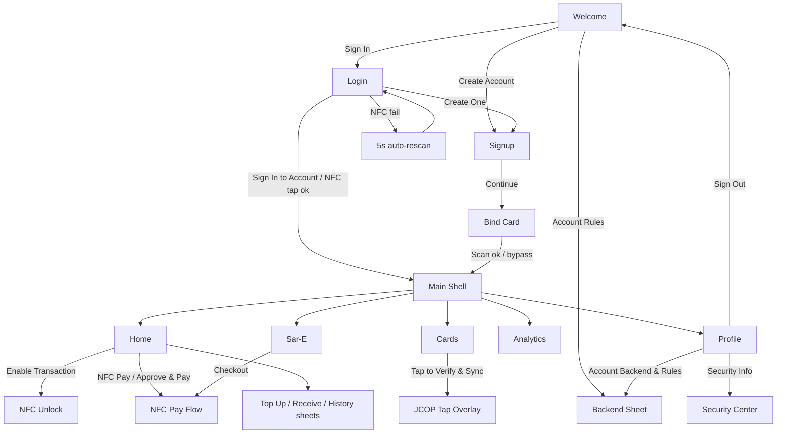

# tap@tan (Bantay) — Figma Prompt V2 (1:1 UI/UX Update)

Extracted from the live Flutter source (`tapatan_app/lib`). Every color, label, button and setting below exists in the app today.

**How to use:** paste **Part A** (Global) first, then each **Screen** block as its own Figma AI / Make prompt (one frame per prompt). Paste **Part C** last to wire the prototype. **Part D** is the optional 3D card upgrade.

---

## PART A — GLOBAL DESIGN SYSTEM (paste first)

```text
Create a dark mobile app design system "Bantay / tap@tan". Frame 393x852. Font: Inter (all weights). Material 3 dark. Icons: Lucide.

COLORS
- Scaffold bg #020B18. Page gradient top->bottom: #000000 0%, #020B18 35%, #031424 65%, #041E35 100%.
- Primary teal #0891B2, deep blue #0369A1, cyan #06B6D4, sky #38BDF8, surface #0C1A2E.
- Success #34D399 (#10B981/#059669 for fills), warning #F59E0B, danger #EF4444 (text #F87171), purple #8B5CF6.
- Text white at 100/85/70/50/35/20% opacity.
- Ambient glow orbs: 320px circle #0369A1 @13% top-left (-80,-80); 220px #0891B2 @10% mid-right; 200px #06B6D4 @7% bottom-left.

COMPONENTS
- GlassButton (r14, pad-v16, text 15 w700-800 white, centered). Primary: gradient TL->BR #0369A1->#0891B2, 1px border white@15%, shadow #0891B2@30% blur20 y6. Secondary: gradient #0C1E35->#0A1628, 1px border #0891B2@35%, shadow #0369A1@30%. Pressed: scale .96. Disabled: 45% opacity, no shadow. Loading: 24px white spinner.
- Standard input: r16, pad 16x4, bg white@5%, 1px border #0891B2@35%, leading icon 20px #38BDF8@80%, text 15 w500 white, hint 14 white@35%.
- GlassCard: gradient TL->BR rgba(3,105,161,.18) -> rgba(8,145,178,.10) -> rgba(6,182,212,.06), 1px border rgba(8,145,178,.22), r20, pad 20, shadow #0369A1@15% blur24 y6.
- Settings/menu tile: r14, pad 14x11, bg white@4%, 1px border white@8%. Switch: thumb #38BDF8, track #0891B2@50%.
- Bottom sheet: top radius 28-32, gradient #041E35->#020B18 (or #031424->#020B18), drag handle 42x4 r2 white@20%.
- Floating bottom nav: h66, 16px side + bottom margin, r28, bg #020B18@80%, 1px border #0891B2@18%, shadow 0 8 32 black@60%. 5 tabs: Home(home) Cards(creditCard) Sar-E(store) Analytics(barChart2) Profile(user). Tab: pad 10x8 r20, icon 19, label 9.5. Active: gradient #0369A1@31%->#0891B2@25%, 1px border #0891B2@40%, icon+label #38BDF8 w700. Inactive: icon white@30%, label white@28%.
- Snackbar: floating, r12, #059669 (success) or #0369A1 (info), 14px white.
- Page transition: fade-upwards. Routes: /auth, /main, /security.
```

---

## PART B — SCREENS (1:1)

### B1. Auth — Welcome
```text
Frame "Auth/Welcome". Page gradient bg + glow orbs (#0369A1@13% TL 320px, #0891B2@9% BR 260px).
- Top-right chip "Account Rules": pad 11x8, r12, bg white@7%, 1px #0891B2@30%, icon settings 15px #38BDF8 + text 11 w600 white@80%. Opens Backend Settings sheet.
- Logo: 88x88, r28, gradient #0369A1->#0891B2, 1px border #38BDF8@50%, shadow #0369A1 blur32 y8, icon shield 42px white.
- Title "Bantay" 30 w900 white (tracking -0.5). Subtitle "Dual-Layered Defense & JCOP J3R150 Hardware Security" 12 white@50% centered.
- 3 feature pills (r16, pad 16x12, bg white@4%), each with 34x34 r10 icon box (color@20%, 1px color@30%) + text 12.5 w600 white@85%:
  1. shieldCheck #0369A1 "JCOP J3R150 Smart Card Security"
  2. store #0891B2 "Dual-Layered Protection with Sar-E Store"
  3. keyRound #06B6D4 "Turing Composition Mutual Authentication"
- Primary GlassButton "Sign In" (shows "Sign In (N Saved Accounts)" when accounts exist) -> Login.
- Secondary GlassButton "Create Account" -> Signup (clears inputs).
```

### B2. Auth — Login
```text
Frame "Auth/Login".
- Nav row: back button 38x38 r12 bg white@8% icon arrowLeft 18 white (-> Welcome) + "Account Rules" chip.
- Title "Welcome Back" 26 w900. Subtitle "Sign in with your registered email & PIN or tap your bound Tapat Card" 13 white@50%.
- If saved accounts exist: label "SAVED ACCOUNTS ON DEVICE" 10.5 w700 white@45% tracking 1.1; horizontal chips h54 r14 pad 12x8: default bg white@5% border white@12%; selected bg #0891B2@22% border #38BDF8. Contents: 14px avatar circle #0369A1 with initial, name 12.5 w700 white, "{email} · {n} tx" 10.5 white@50%. Tap fills the email field.
- Email input (icon mail, hint "Registered email address").
- PIN input (icon lock, hint "{min}-{max} Digit Account PIN", obscured numeric, suffix eye/eyeOff 18 white@40%).
- Primary GlassButton "Sign In to Account" (loading = spinner) -> /main.
- Divider lines white@10% with "OR" 11 bold white@30%.
- NFC button: r16 pad 16x14, gradient rgba(3,105,161,.25)->rgba(8,145,178,.20), 1px #0891B2@40%, icon wifi 18 #38BDF8, label 13.5 bold #38BDF8. States: "Tap Bound Tapat Card to Sign In" / "Ready: Tap Bound Tapat Card Now..." (spinner) / "Failed — Re-scanning in {N}s (Tap to retry now)".
- Footer "Don't have an account? Create One" 13 white@50%, link bold #38BDF8 -> Signup.
```

### B3. Auth — Signup (step 1) and Bind Card (step 2)
```text
Frame "Auth/Signup": back + Account Rules chip. Title "Create Account" 26 w900; subtitle "Step 1 of 2: Account Profile & {max}-Digit PIN".
Inputs (standard): user "Full Name"; mail "Email address (e.g. name@email.com)"; phone "Mobile Number (+63 9XX XXX XXXX)" numeric; lock "{min}-{max} Digit Card PIN" password numeric; lock "Confirm Card PIN".
Primary GlassButton "Continue to Tapat Card" + arrowRight 16 -> Bind Card. Footer "Already registered? Sign In" -> Login.

Frame "Auth/BindCard": back button. Title "Bind Tapat Card" 26 w900; subtitle "Step 2 of 2: Hold your JCOP J3R150 smart card to bind it to {Name}" centered.
Pulsing NFC target (scale 1->1.15, 1400ms): outer 180 circle #0891B2@12%; middle 130 #0369A1@20%; hub 96 circle gradient with shadow blur30:
 - Idle: #0369A1->#0891B2, icon wifi 42 white
 - Scanning: same gradient, icon refreshCw
 - Success: #10B981->#059669, icon checkCircle
 - Error: #991B1B->#EF4444, icon wifi
Status text 15 bold centered: "Ready to Tap Card" (white) / "Writing Turing identity to card secure element..." / "Account Saved & Card Bound — Routing to Home..." (#34D399) / "Recognition failed — Auto re-scanning in {N}s..." (#F87171).
Subtext 12 white@40%: "Single-tap Turing Composition binding · Account & history persist in database."
Primary GlassButton: "Scan Physical Tapat Card" / "Scanning Card..." / "Re-scanning in {N}s (Tap to Scan Now)" -> /main.
Bypass button: r16 pad-v14 bg white@5% border white@15%, text "Create Account Without Card (Bind Later)" 13 bold #38BDF8 -> /main.
```

### B4. Camera Capture Overlay and Face Liveness
```text
Frame "CameraCapture": full-screen camera preview. Dim layer black@62% with clear cutout at 42% height: document mode 85% width x 58% of width, r16, 2px #38BDF8 border + 4 corner brackets (24px, 3px, round); face mode oval 65% x 80% of width. Animated scan line 2px, horizontal gradient transparent->#38BDF8@80%->transparent, ping-pong 1800ms. Top bar: close 40x40 r12 bg black@50% border white@20% icon x 20; title 16 w800 white + subtitle 11 white@55%. Bottom capture button: 80px white circle, 4px #0891B2 border, glow pulse, camera icon 32 #0369A1 (capturing = 24px spinner).
States: loading bg #020B18 spinner #0891B2 "Starting camera..." (14 white@54%); error icon cameraOff 48 #EF4444 "Camera unavailable" + pill button "Go Back" (gradient #0369A1->#0891B2, r50, pad 24x12).

Frame "FaceLiveness": full-screen front camera, dim black@65%, oval cutout (center y 40%, 68% x 85% of width) with double glowing border (pulses .4->1, 1600ms) colored by step: detecting #0891B2, blink #F59E0B, smile #8B5CF6, done #10B981. Top bar: close X, title "Face Liveness Check", subtitle "On-device • No data sent to servers".
Bottom card r24 pad20 bg black@75% border frameColor@50% glow: 3 step dots (inactive 10x10 white@20%, active 28x10 frameColor); row: 44px icon circle (scanFace/eye/smile/checkCircle, frameColor) + headline 15 w800 + subtext 11 white@50%; 6px progress bar (0 -> .33 -> .66 -> 1).
Copy sequence: "Position your face in the oval"/"Keep your face centered and steady" -> "Face detected — hold steady"/"Analyzing biometrics..." -> "Blink your eyes"/"Slowly blink both eyes once" -> "Now smile 😊"/"Give a natural smile" -> "Liveness Confirmed ✓"/"Identity verified successfully".
```

### B5. Account Management Backend Sheet (settings)
```text
Bottom sheet, max height 86%, top r28, gradient #041E35->#020B18, pad 22. Handle 42x4.
Header: 38x38 r12 icon box (#0891B2@20%, shieldCheck 20 #38BDF8); title "Account Management Backend" 17 w800; subtitle "{N} persistent account(s) stored in database" 11.5 white@50%.
Tiles (settings tile + switch):
 1. "Sync with Remote Node Backend" / "Mirror local persistent DB with tapatan_backend REST API"
    -> when ON show URL box (r14 bg white@6% border #0891B2@35%): hint "http://192.168.1.100:4180 (or 127.0.0.1:4180 / 10.0.2.2:4180)", text-button "Test"/"Testing..." (12 w700 #38BDF8); result line: error #F87171 "Failed to reach backend server." / success #34D399 "Connected to tapatan-account-backend ({count} remote account(s))."
 Section label "CONFIGURABLE ACCOUNT RULES" 10.5 w700 white@45% tracking 1.2.
 2. "Default Starting Balance (PHP)" / "Initial wallet balance for newly created accounts" — 96px input r10 bg white@6%, prefix "₱" #38BDF8, value 14 w800 #38BDF8 right-aligned.
 3. "Require PIN on Email Sign-In" / "Verify salted SHA-256 PIN hash when logging into stored accounts"
 4. "Strict Card-to-Account Binding" / "NFC tap sign-in resolves strictly to bound database account"
 5. "Allow Card Rebind on New Signup" / "Allow re-provisioning a Tapat JCOP4 card to a new account"
 6. "Sync Card Holder Name with Account" / "Always display the authenticated user's real name on cards"
Primary full-width button "Save Account Configuration" (r16 pad-v15, gradient #0369A1->#0891B2, 14.5 w800) -> closes sheet + snackbar "Account management rules saved."
```

### B6. Home
```text
Frame "Home" (scroll, pad 20 / top 16 / bottom 130). Order:
1. [conditional] Sar-E Pending Order banner: gradient #0369A1->#0891B2->#06B6D4, r20, 1.5px #38BDF8@50%, pad16. Header icon store, title "Sar-E Payment Request" 14 bold, merchant 11 white@80%, "Pending" pill #F59E0B. Items box bg black@15% r12 with item lines + total "₱XX.XX" 16 w900. Buttons: white "Approve & Pay (Tapat)" (wifi icon, text #0369A1 -> opens NFC Pay) and ghost "Decline" (bg white@12%, clears order).
2. Card status banner (pad 14x9, r14, 7px dot, wifi 12px, text 11 w600): Armed (#34D399@8% bg) "NFC Card · Armed — 1 transaction ready"; Used (#F59E0B) "NFC Card · Transaction used — re-tap to rearm"; Inactive (white@4%) "NFC Card · Not activated".
3. Greeting: "<Good morning/afternoon/evening>" 13 white@50% + name 22 w800; bell button 42px circle bg white@7% border #0891B2@30% with 10px #0891B2 unread pip.
4. [if not armed] "Enable Transaction" CTA: gradient #0369A1@44%->#0891B2@38%->#06B6D4@31%, r20, pad 15x16; 40px icon box (shield), subtitle "Tap NFC card to arm for payment", chevronRight -> NFC Unlock.
5. Balance card r26 pad20 gradient #0369A1@44%->#0891B2@35%->#06B6D4@25%: "Total Balance" 12 + eye/eyeOff toggle; amount "₱ XX,XXX.XX" 30 w900 (hidden "₱ ••••••••"); divider; Income (trendingUp, #34D399 circle) | Expenses (arrowUpRight, #F87171 circle).
6. Active card pill (r18 pad 14x12 bg #0369A1@10% border #0891B2@25%): 42px gradient icon wifi, "<Provider> Active · <Holder>", "<Number> · Ready for NFC", green pip, chevron -> Cards tab.
7. Quick actions (4 cols, gap 10, r18, border #0891B2@20%): Send (arrowUpRight) / Receive (arrowDownLeft) / NFC Pay (wifi) / Top Up (plus); 38px icon box, label 10 w600.
8. Weekly Spending card (r22 bg white@4%): "Weekly Spending" + chip "This week"; 7 bars Mon-Sun, gradient #0369A1->#0891B2, h75.
9. Recent Activity: header + "See all >"; rows r16 pad12 (40px color icon box, name 13 w600, time 11, amount +₱ #34D399 / -₱ #F87171); empty state icon activity 36, "No transactions yet".
10. Sar-E promo card: "Shop on Sar-E Store" / "Sari-sari store catalog with 1-tap card checkout" + "Open >" button -> Sar-E tab.
Sheets: Top Up (title "Top Up Balance", subtitle "Quick-select or enter custom amount", chips ₱100/₱500/₱1000/₱5000 selected green gradient, custom "₱" input 28 w700, CTA "Top Up Now" green gradient); Receive ("Receive Money", 140px QR placeholder, ACCOUNT NAME / ACCOUNT EMAIL); History ("Transaction History", "<n> entries", draggable 0.4-0.9, gradient #120832->#0A0020).
```

### B7. Cards (current design — see Part D for 3D upgrade)
```text
Frame "Cards" (pad 24, bottom +100). Header "Cards" 26 bold + 40x40 r12 gradient button (plus / x toggles Add form).
Add Virtual Card form (r20 pad20, 1px #0891B2@30%): title "Add Virtual Card"; fields "Bank / Provider", "Card Number", "Card Holder Name", row "MM/YY" + "CVV"; type chips "VISA" / "Mastercard" (active gradient, inactive white@6%); buttons "Cancel" and "Add Card".
Empty state: creditCard 48, "No virtual cards", "Add a card to track your balances", button "Add Card".
Card tile (r22 pad22, shadow color@35% blur20): Visa gradient #1E3A5F->#0369A1; Mastercard #3B0764->#7C3AED; active = 1.5px white@40% border + "ACTIVE" chip. Provider 16 bold; network "VISA"/"MASTERCARD" 13 white@70%; number "•••• •••• •••• 1234" 17 w600 spacing 2; row CARD HOLDER / EXPIRES / AVAILABLE MONEY ("₱" 13 w800 #38BDF8); buttons "Set Active" (hidden if active) and "Delete" (trash2, red).
Tapat Card hardware panel (r24 pad20, gradient #0369A1@25%->#0891B2@15%->#06B6D4@8%, 1px #06B6D4@30%): icon box creditCard, "Tapat Card" / "JCOP J3R150 · Hardware"; lifecycle chip: ENROLLED #34D399, PERSONALIZED #06B6D4, PIN_SET #F59E0B, PIN_BLOCKED/TERMINATED #F87171, UNKNOWN grey. 2x2 stats: Hardware UID, PIN Tries Left "n / 5" (BLOCKED red), Signature Counter, Card ID. Button "Tap to Verify & Sync Card" (nfc icon; reading state "Reading…" spinner) + status line 11 white@50%.
```

### B8. Sar-E Store
```text
Frame "Sar-E" (pad 24, bottom +120). Header: 48px gradient store avatar, "Sar-E Store" 22 bold, "Sarisari ni Aling Nena" 12 #38BDF8, balance pill ("Available Money" 9 / "₱{balance}" 13 bold #38BDF8). Amber banner (r10 #F59E0B@8%): creditCard icon + "Pay securely with your Tapat Card".
Product tile (r16 pad 16x14; border #0891B2@18% idle, #06B6D4@40% when qty>0): 44px thumbnail (shoppingBag), name 13 w600, price 13 w700 #38BDF8, stepper: 30px red "x" (disabled when 0), qty 15 bold, 30px "plus".
Items: Kopiko Coffee 3-in-1 (10 sachets) ₱55; Lucky Me Pancit Canton ₱15; San Miguel Pale Pilsen (6-pack) ₱155; Great Taste White Coffee ₱18; Bear Brand Sterilized Milk ₱95; Boy Bawang (Big, 3 flavors) ₱45; Piattos Cheese 85g ₱38; Skyflakes Crackers (10pcs) ₱22.
Floating cart bar (visible when cart>0; bottom 96, sides 16, r20, gradient #0369A1->#0891B2->#06B6D4): cart icon + amber count badge, "{n} item(s)", total 16 bold, white "Checkout" button (creditCard, #0369A1) -> Home NFC Pay.
```

### B9. NFC Unlock (Arm Card) and NFC Pay Flow
```text
Frame "NFC Unlock": bg #020B18@94%. Header: back button, "Arm Tapat Card" 20 bold, "NFC Authentication" 12 white@38%. 220px pulsing rings (#06B6D4) around a 72px icon box: scanning gradient #0369A1->#0891B2 nfc icon; success #065F46->#047857 badgeCheck (ring #34D399); error #7F1D1D->#991B1B alertTriangle (ring #EF4444). Status 18 w600: "Hold your Tapat Card to the back of your phone" / "Scanning… Hold Tapat Card near phone" / "Tapat JCOP4 Card verified via Turing Composition!" (#34D399) / "Unauthorized Card" or "Scan failed" (#F87171). Retry text "Re-scanning automatically in {n}s..." (#06B6D4). Buttons: "Try Again"/"Re-scanning in {n}s (Tap to Scan Now)", "Arm via Provisioned JCOP4 Card" (#34D399), "Cancel". Footer: "Proximity-bound · Turing Composition · Single-Tap Locked".

Frame "NFC Pay Flow" (bottom sheet #18181B, top r32): title "NFC Pay Flow", subtitle "Real NFC · Privacy-preserving payment". Steps: Idle ("Start Payment Flow") -> Amount ("TRANSACTION AMOUNT (₱)", 28 bold input, Cancel/Continue) -> PIN if >= ₱100 ("ENTER PIN (Step 1 of 2)", retries badge "<n> tries left"/"LOCKED", note "PIN verified on-card · Retry limit enforced by hardware") -> OTP if >= ₱1000 ("EMAIL OTP (Step 2 of 2)", "Demo OTP: 123456") -> Authenticating ("Hold phone to JCOP4 NFC Card...") -> Ready/Success (green banner "Card Read & Acknowledged — Payment Approved!", token chip, "Expires in M:SS" bar green>yellow>red, buttons "Payment Approved — Done", "Disarm / Revert Card") or Error (red banner, "Re-scanning automatically in {n}s...", "Try Again").

Overlay "JCOP Tap": bg #020B18@90%; title "Hold Card Still"/"Authenticated"(#10B981)/"Authentication Failed"(#EF4444); 160px animated card; 5-step bar: Connecting, SELECT, Challenge, Auth, Done; buttons "Try Again", "Cancel"/"Stop"; footer "Proximity-bound · Not relayable".
```

### B10. Analytics
```text
Frame "Analytics" (pad 24/20, bottom +100). Header "Analytics" 26 bold + segmented "Week"/"Month" (container r12 bg white@6%, active gradient #0369A1->#0891B2). Sync GlassCard: "Available Money ({name})", "₱{balance}" 24 w800 #38BDF8, badge "Synced" (#34D399). Two summary cards (arrowUpRight #F87171 "Total Spent"/"Monthly Spent", arrowDownLeft #34D399 "Total Income"/"Monthly Income"). "Spending Overview" bar chart h160 (Mon–Sun or Wk 1–Wk 4, bars gradient #0369A1->#06B6D4, r6). "By Category": NFC Pay (wifi #06B6D4), Transfers (arrowUpRight #8B5CF6), Sar-E Purchases (store #F59E0B) with 5px progress bars. Banners: "Sar-E Purchases" (This week/This month) and "NFC Transactions" ("{n} taps total", big number 28 #38BDF8).
```

### B11. Profile, Security Center, Help
```text
Frame "Profile" (pad 20/16/120). Hero card r28 gradient #0369A1@35%->#0891B2@28%: 64px gradient avatar with initials, name 17 w800 + "PRO" amber badge, email 12; stats row (Cards / Transactions / NFC Pays).
Sections (title 11 w700 tracking 1.5 white@40%; card r24 bg white@4%; rows pad 16x14, 32px colored icon box, chevron):
 ACCOUNT: Personal Information (user) · Linked Banks & Cards (creditCard, count badge -> Cards tab) · Account Backend & Rules (settings -> Backend sheet) · Upgrade to Premium (star, amber)
 SECURITY: Change PIN (lock) · Biometric Auth (fingerprint, switch ON) · Privacy Settings (shield) · Security Info & Card Lock (info -> /security)
 PREFERENCES: Notifications (bell, switch ON) · NFC Debug Console (wifi, switch OFF)
 SUPPORT: Help Center (helpCircle) · Sign Out (logOut, red -> /auth; data persists)
Footer: "Secured by end-to-end encryption" + "tap@tan v1.0.0 · Build 2025.06".
Sheets: Personal Information (Full Name, Email, Account Type "Individual", Member Since; "Close"); Change PIN ("Update your account & card authentication PIN"; Current PIN / New PIN / Confirm New PIN, 6-digit spaced; "Save PIN"); Help Center (draggable; FAQs: How does NFC payment work? / How do I arm my card? / What happens after a payment? / How do I add a virtual card? / Is my data secure?).

Frame "Security Center": back button, "Security Center", "Tapat Card · JCOP J3R150". Six GlassCards with key/value rows: ECDSA P-256 Key (keyRound) · Signature Counter (activity) · PIN Lockout Policy (lock, 5 attempts) · Progressive Auth Tiers (Micro <₱100 Tap-and-go; Low ₱100–₱500 Card tap; Medium ₱500–₱5000 Card + PIN; High >₱5000 Card + PIN + OTP) · STRIDE Threat Model (S,T,R,I,D,E rows) · Card Lifecycle States (PERSONALIZED, PIN_SET, ENROLLED, PIN_BLOCKED, TERMINATED).
```

---

## PART C — PROTOTYPE FLOW (wire in Figma)



Interactions: tap = Smart Animate 300ms ease-out; sheets = Move In Bottom 350ms; NFC success = fade to Home + green snackbar; retry rings = After Delay 5000ms back to scanning.

---

## PART D — OPTIONAL 3D INTERACTIVE CARDS UPGRADE (replaces B7 card tiles; keep all B7 forms/buttons)

```text
Upgrade the Cards tab keeping every existing control from B7. Keep the real card styling (Visa #1E3A5F->#0369A1, Mastercard #3B0764->#7C3AED, Tapat hardware panel).
- Hero stage (perspective 1200): current card floats at rotateX 8 / rotateY -12 with soft colored floor shadow; drag shifts a holographic sheen and parallaxes chip, number and name at different depths.
- Controls dock (glass pills): "Flip" (180° spring, 550ms: back shows CVV with tap-to-reveal 10s, Hardware UID, AID F07461706174616E0101), "X-Ray" (explode into 3 layers: card body, copper antenna coil pulsing #06B6D4, JCOP J3R150 die showing PIN tries and lifecycle), "Tap to Verify & Sync Card" (shockwave ring + same flow as B7), "Delete"/"Set Active" stay.
- Swipe vertically for a 3D fan deck of virtual cards + the Tapat hardware card; "Add Card" opens the same Add Virtual Card form with a live rotating mini preview.
```

